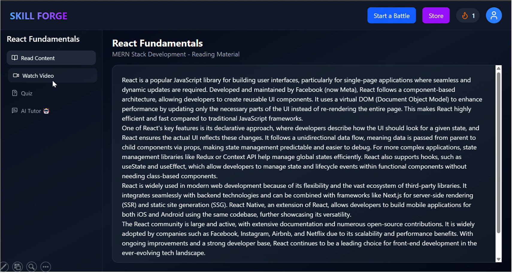

# SkillForge (EduGenie)

SkillForge, called **EduGenie** in the interface, organizes course material by semester, subject and unit. Students can move from a reading or video to a quiz, then ask a tutor to explain the material using the course document. The student client also includes assessment and interview-practice screens.

*The SkillForge project interface. This public checkout uses the EduGenie name.*

## How a study session works

| Part | What it does |
| --- | --- |
| React and Vite, in `src/` | Renders the course navigation, readings, videos, assessments and chat. The course structure is in `src/data.json`. |
| Express and MongoDB, in `backend/` | Handles registration and sign-in through a Mongoose model. |
| Flask, in `flask/app.py` | Sends documents and questions to ChatPDF and exposes quiz, assessment and feedback routes to the client. |

Start with `src/App.jsx` to trace the student experience from sign-in through a unit. Personalized roadmaps and head-to-head quizzes were part of the broader project.

## Exploring the project locally

Run each component in its own terminal with development accounts and sample course material.

| Component | Local setup |
| --- | --- |
| Course interface | From the root, run `npm ci` and `npm run dev`. |
| Accounts | Configure a development MongoDB connection in `backend/index.js`. From `backend/`, run `npm ci` and `npm start`. The client expects port 3001. |
| Tutor and assessments | Configure your ChatPDF key and document source IDs in `flask/app.py`. In a Python virtual environment, install Flask, Flask-Cors and Requests, then run `python flask/app.py` from the root. The client expects port 5000. |

## Development opportunity

A small sample course with a documented test account and a local tutor fixture would let contributors try a complete lesson, quiz and feedback cycle before configuring external services.
